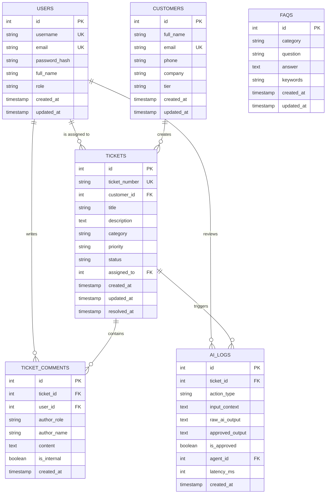

# Tài liệu thiết kế cơ sở dữ liệu (Database Design Specification) - Đề tài 10

## 1. Mô hình thực thể và quan hệ (Entity-Relationship Model)

### Sơ đồ thực thể quan hệ (ERD - Mermaid)

## 2. Chuẩn hóa dữ liệu (Normalization)
- **1NF**: Mọi thuộc tính đều mang giá trị nguyên tử (atomic), không chứa mảng hay chuỗi lặp không chuẩn.
- **2NF**: Mọi thuộc tính không khóa đều phụ thuộc hoàn toàn vào khóa chính của từng bảng.
- **3NF**: Không có sự phụ thuộc bắc cầu giữa các thuộc tính không khóa (ví dụ thông tin công ty khách hàng gắn với `customers`, không lặp lại trong `tickets`).

## 3. Ràng buộc toàn vẹn và Chỉ mục (Constraints & Indexes)
1. **Khóa ngoại (Foreign Keys)**:
   - `tickets.customer_id` -> `customers.id` (ON DELETE CASCADE)
   - `tickets.assigned_to` -> `users.id` (ON DELETE SET NULL)
   - `ticket_comments.ticket_id` -> `tickets.id` (ON DELETE CASCADE)
   - `ai_logs.ticket_id` -> `tickets.id` (ON DELETE SET NULL)
2. **Kiểm tra hợp lệ (CHECK Constraints)**:
   - `users.role` IN (`admin`, `lead`, `agent`)
   - `customers.tier` IN (`Standard`, `VIP`)
   - `tickets.priority` IN (`Low`, `Medium`, `High`, `Urgent`)
   - `tickets.status` IN (`New`, `In Progress`, `Waiting Customer`, `Closed`)
3. **Chỉ mục (Indexes)**:
   - Tối ưu hóa truy vấn tìm kiếm lọc ticket theo `status`, `priority`, `customer_id`, `assigned_to`.
   - Tối ưu hóa truy vấn chuỗi trao đổi theo `ticket_id`.

