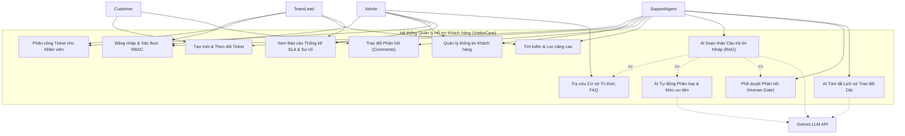
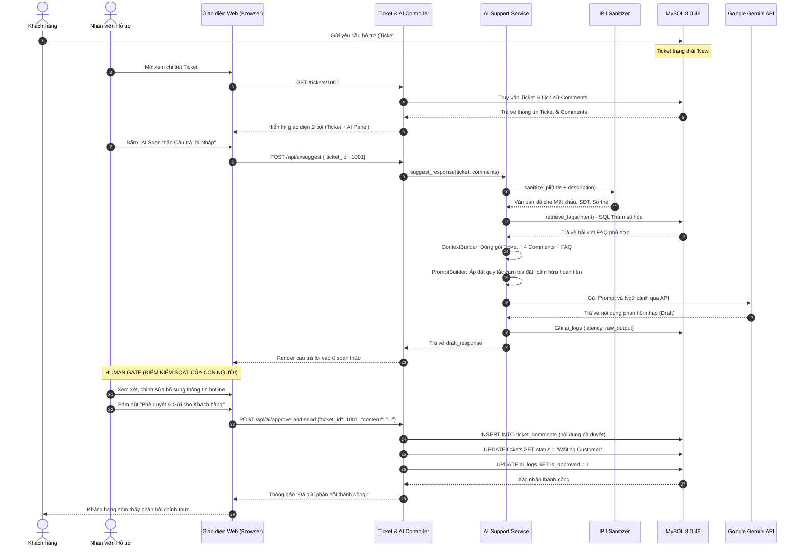
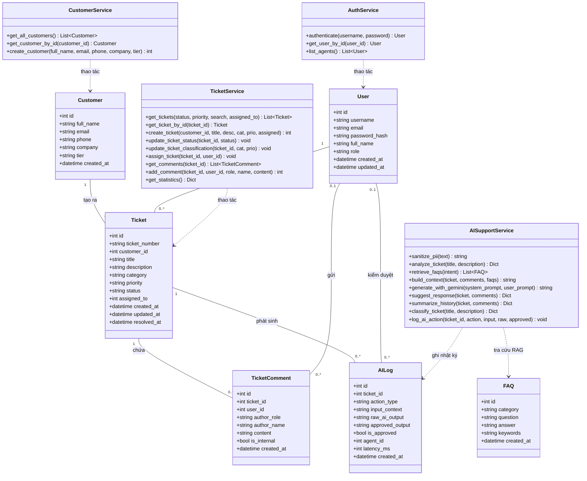
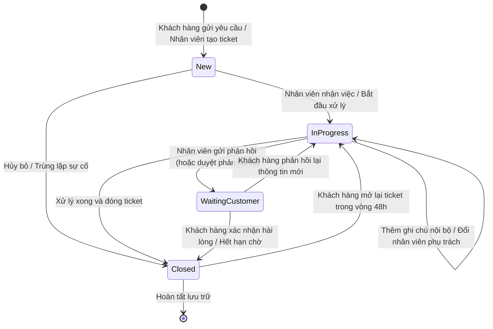
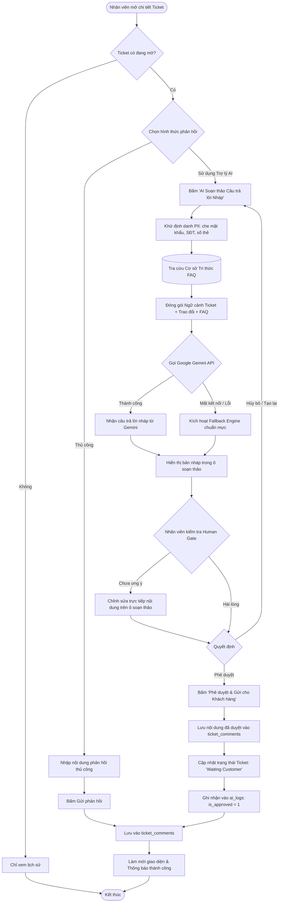
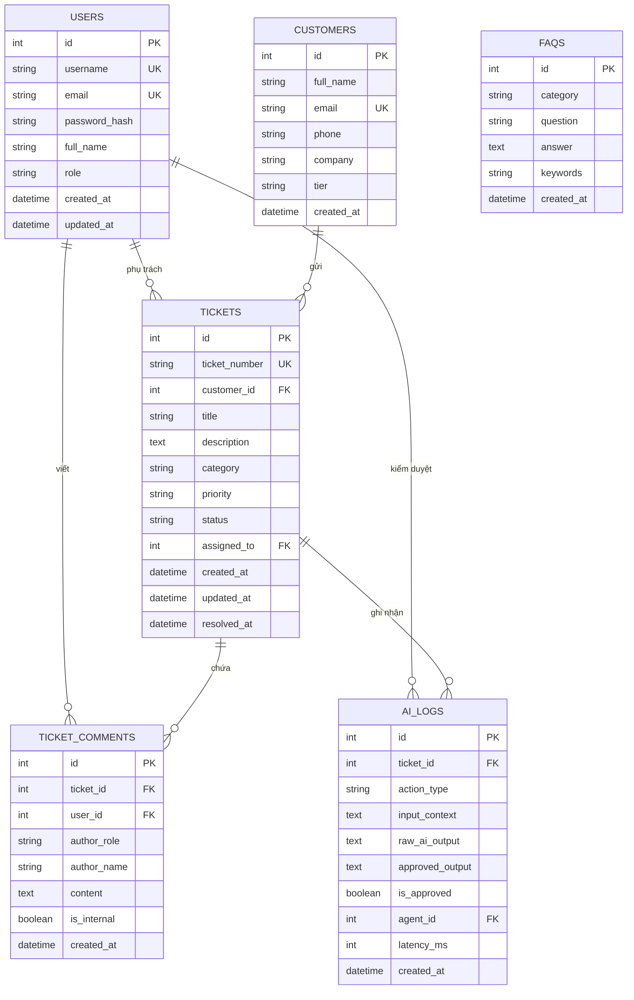

# Tài liệu Thiết kế Biểu đồ UML (UML Design Specification) - Đề tài 10

Tài liệu này đặc tả toàn bộ hệ thống quản lý hỗ trợ khách hàng ViettinCare thông qua các biểu đồ UML chuẩn hóa (chuẩn Mermaid): Use Case, Sequence, Class, State Machine, Activity và ERD.

---

## 1. Biểu đồ Ca sử dụng (Use Case Diagram)

Hệ thống có 5 tác nhân chính:
- **Admin**: Quản trị viên hệ thống
- **Team Lead**: Quản lý nhóm hỗ trợ
- **Support Agent**: Nhân viên chăm sóc và hỗ trợ kỹ thuật
- **Customer**: Khách hàng sử dụng dịch vụ
- **Gemini LLM**: Hệ thống AI bên thứ ba

---

## 2. Biểu đồ Tuần tự (Sequence Diagram)

### Luồng xử lý: Nhân viên sử dụng Trợ lý AI & Phê duyệt Phản hồi (Human Gate)

Biểu đồ mô tả chi tiết tương tác khi nhân viên mở ticket, yêu cầu AI gợi ý câu trả lời, đối chiếu FAQ, lọc PII và bấm nút phê duyệt gửi cho khách hàng.

---

## 3. Biểu đồ Lớp (Class Diagram)

Biểu đồ biểu diễn các lớp thực thể (Entities), các lớp dịch vụ (Services) và quan hệ cấu trúc trong mã nguồn.

---

## 4. Biểu đồ Máy trạng thái (State Machine Diagram)

Vòng đời trạng thái của một Ticket trong hệ thống ViettinCare:

---

## 5. Biểu đồ Hoạt động (Activity Diagram)

Quy trình xử lý phản hồi AI và quyết định của con người:

---

## 6. Biểu đồ Thực thể Liên kết (Entity Relationship Diagram - ERD)

