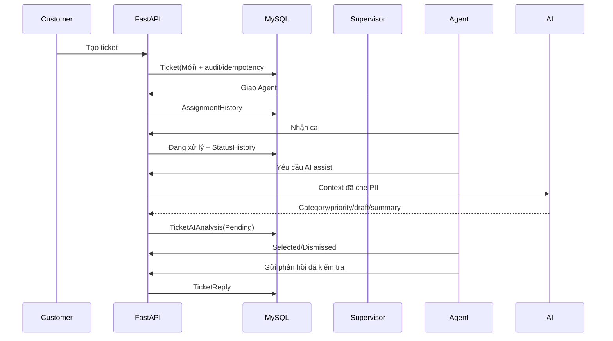
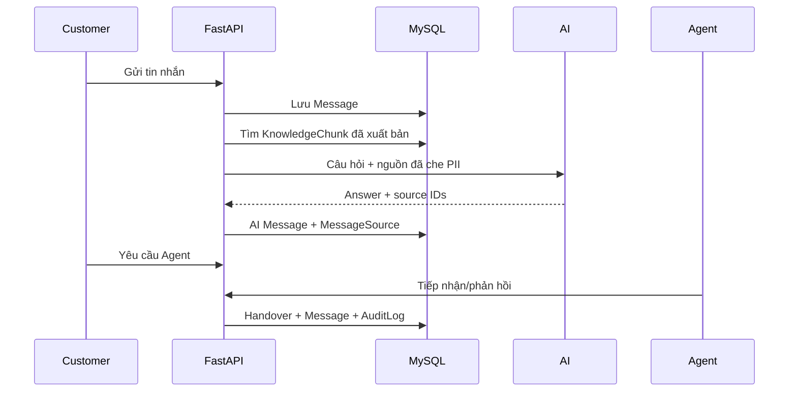

# Thiết kế luồng hiện hành

## Ticket

## Chat RAG và handover

## Quan hệ vai trò

- Customer sở hữu ticket/chat và đánh giá ticket đóng.
- Agent xử lý ticket/handover được giao.
- Supervisor phân công, giám sát, quản lý liên hệ và báo cáo.
- Admin quản lý tài khoản, tri thức, cấu hình và audit.
